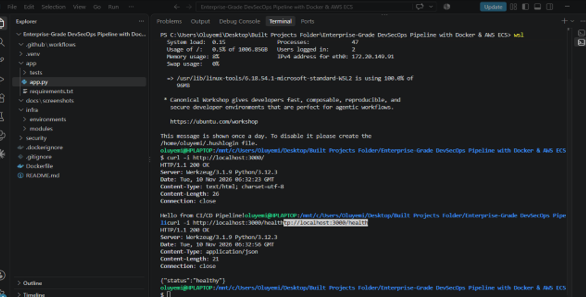
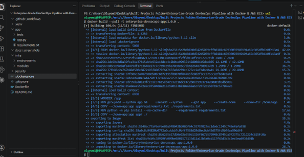
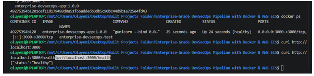
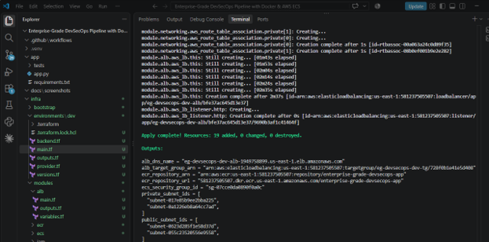
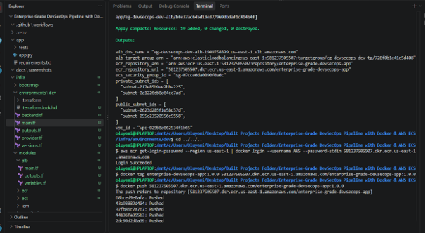
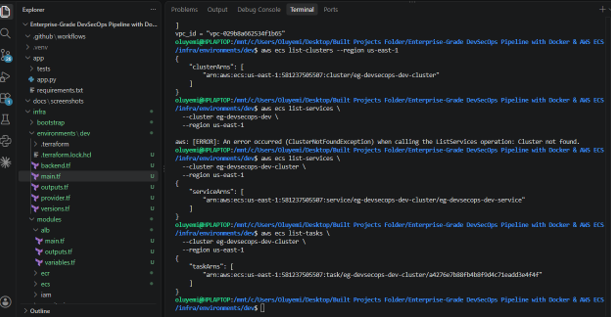
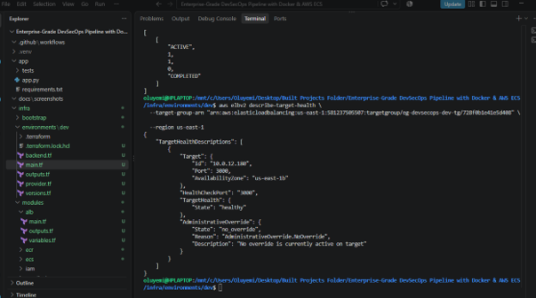
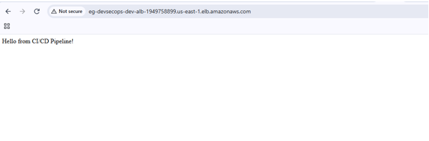
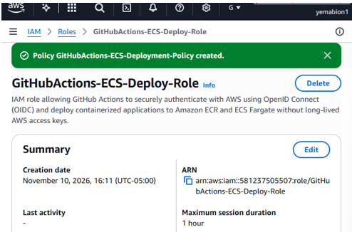
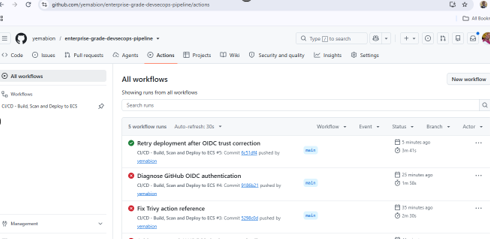

# Enterprise-Grade DevSecOps Pipeline with Docker & AWS ECS

## Project Overview

This project demonstrates an automated DevSecOps pipeline for building, testing, scanning, and deploying a containerized Flask application to Amazon ECS Fargate.

It combines Docker, Terraform, AWS services, GitHub Actions, and OpenID Connect (OIDC) authentication to demonstrate Infrastructure as Code, containerization, CI/CD automation, and cloud deployment.

The application returns:

`Hello from CI/CD Pipeline!`

## Architecture

The deployment follows this workflow:

1. Developers push application changes to GitHub.
2. GitHub Actions checks out the source code and runs automated Flask tests.
3. Docker builds the application image.
4. Trivy scans the image for vulnerabilities.
5. GitHub Actions authenticates with AWS using OIDC.
6. The Docker image is pushed to Amazon ECR.
7. A new ECS task definition is registered with the updated image.
8. Amazon ECS Fargate deploys the application.
9. An Application Load Balancer routes traffic to the running container.

## AWS Infrastructure

The infrastructure is provisioned using reusable Terraform modules.

| Component | Purpose |
|---|---|
| Amazon VPC | Isolated cloud network |
| Public and private subnets | Network segmentation across two Availability Zones |
| Internet Gateway | Internet connectivity for public resources |
| NAT Gateway | Outbound internet access for private resources |
| Security Groups | Control network traffic |
| Amazon ECR | Docker image storage |
| Amazon ECS Fargate | Container orchestration and hosting |
| Application Load Balancer | Distributes application traffic |
| Amazon CloudWatch | Container logs |
| Amazon S3 | Remote Terraform state storage |

## Technology Stack

- **Application:** Python, Flask
- **Containerization:** Docker
- **Infrastructure as Code:** Terraform
- **Cloud Platform:** AWS
- **Container Registry:** Amazon ECR
- **Container Platform:** Amazon ECS Fargate
- **CI/CD:** GitHub Actions
- **Security Scanning:** Trivy
- **Authentication:** GitHub Actions OIDC
- **Monitoring and Logs:** Amazon CloudWatch

## CI/CD Pipeline

The GitHub Actions workflow automates the application delivery process.

- Automated application testing with pytest.
- Docker image build.
- Container vulnerability scanning with Trivy.
- Secure AWS authentication using OIDC instead of long-lived AWS access keys.
- Image publishing to Amazon ECR.
- ECS task definition registration and service deployment.
- Deployment stability verification.

## Security Considerations

The project incorporates several security practices:

- GitHub Actions uses OIDC-based AWS authentication.
- IAM permissions are assigned through a dedicated deployment role.
- ECS containers run in private subnets.
- Security groups restrict application traffic to the load balancer.
- ECR image scanning is enabled.
- Terraform state is stored remotely in an encrypted, versioned S3 bucket.
- Terraform state locking uses S3 lock files.

**Note:** The current demonstration uses HTTP through the Application Load Balancer. HTTPS with an ACM certificate is a potential future enhancement.

## Implementation Evidence

The following screenshots document the project implementation and deployment.

### Application and Docker

**Figure 1 – Local Application Tests**



**Figure 2 – Docker Image Build**



**Figure 3 – Healthy Docker Container**



### AWS Infrastructure and Deployment

**Figure 4 – Terraform Infrastructure Deployment**



**Figure 5 – Docker Image Pushed to Amazon ECR**



**Figure 6 – Amazon ECS Service Running**



**Figure 7 – Application Load Balancer Target Health**



**Figure 8 – Live Application Through the Load Balancer**



### CI/CD and IAM Security

**Figure 9 – GitHub Actions OIDC IAM Role**



**Figure 10 – Successful GitHub Actions Pipeline**



## Key Learning Outcomes

Through this project, I demonstrated practical experience with:

- Building and testing containerized applications.
- Designing AWS infrastructure using Terraform modules.
- Deploying applications using Amazon ECS Fargate.
- Automating CI/CD pipelines with GitHub Actions.
- Implementing secure cloud authentication with OIDC.
- Integrating container vulnerability scanning.
- Managing remote Terraform state.

## Repository Structure

```text
.
├── .github/
│   └── workflows/
│       └── ci.yml
├── app/
│   ├── tests/
│   ├── app.py
│   └── requirements.txt
├── docs/
│   └── screenshots/
├── infra/
│   ├── bootstrap/
│   ├── environments/
│   │   └── dev/
│   └── modules/
│       ├── networking/
│       ├── security/
│       ├── ecr/
│       ├── ecs/
│       └── alb/
├── Dockerfile
├── .dockerignore
├── .gitignore
└── README.md
```

## Author

**Cloud & DevOps Engineering Portfolio Project**

GitHub Repository: https://github.com/yemabion/enterprise-grade-devsecops-pipeline


## Implementation Evidence

The following screenshots demonstrate the implementation and successful deployment of the project.

### Application Testing


### Docker Containerization


### AWS Infrastructure


### Amazon ECR


### Amazon ECS


### Application Load Balancer


### GitHub Actions and OIDC


